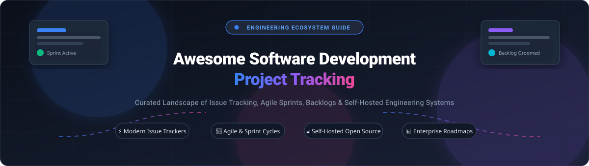

# 🚀 Awesome Software Development Project Tracking

[-blue.svg)](#)

  <b>A comprehensive, SEO-optimized curated landscape of top SaaS platforms and open-source software project tracking tools.</b> 
  <i>Empowering engineering leaders, scrum masters, product managers, and developers with verified pricing, free tier limits, company valuations, and real-time GitHub metrics.</i>

---

## 📑 Table of Contents
- [🌐 Sector Overview & Market Dynamics](#-sector-overview--market-dynamics)
- [🏢 SaaS & Hosted Platforms](#-saas--hosted-platforms)
- [🔓 Open-Source GitHub Projects](#-open-source-github-projects)
  - [⭐ Open-Source Ranking by Stars](#-top-open-source-software-project-tracking-tools-ranked-by-stars)
  - [🔥 In-Depth Open-Source Breakdown](#-in-depth-open-source-breakdown)
- [🤝 How to Contribute](#-how-to-contribute)
- [💖 Support](#-support)
- [📈 Star History](#-star-history)
- [⚖️ Disclaimer & Evaluation Guidelines](#-disclaimer--evaluation-guidelines)

---

## 🌐 Sector Overview & Market Dynamics

The global **Project Portfolio Management (PPM) & Software Development Issue Tracking** software market is valued at approximately **$6.2 Billion in 2024–2025 and is projected to expand to over $11.4 Billion by 2030** (growing at a ~10.8% CAGR), driven by remote-first engineering teams, AI-augmented issue triaging, and continuous deployment workflows. 

The sector is **moderately fragmented yet top-heavy with strong network effects**: giant incumbent ecosystems (Microsoft, Atlassian, GitLab) control enterprise governance and pipeline integration, while specialized challenger platforms (Linear, ClickUp, Plane) aggressively capture fast-moving startups and product-led teams seeking developer ergonomics and low latency.

---

## 🏢 SaaS & Hosted Platforms

> [!NOTE]
> Platforms are sorted in descending order by estimated company valuation / market capitalization. Pricing and free tiers reflect public tier benchmarks.

| 🏢 Platform | 💰 Valuation / Company Size | 🏷️ Starting Tier Pricing | 🎁 Free Tier Limits / Free Trial | 🔍 Focus & Highlights |
| :--- | :--- | :--- | :--- | :--- |
| **[Azure Boards](https://azure.microsoft.com/en-us/products/devops/boards)** 💻 | **~$3.1 Trillion** (Microsoft Market Cap) | **$6 / user / month** (Azure DevOps Basic tier after 5 users) | **Free forever for up to 5 users** with unlimited private Git repos, Kanban boards, backlogs, and work items | Deep native integration into Microsoft Azure DevOps, Visual Studio, and GitHub enterprise toolchains. |
| **[GitHub Issues](https://github.com/features/issues)** 🐙 | **~$100+ Billion** (Division of Microsoft / $7.5B acquisition) | **$4 / user / month** (GitHub Team plan; $21/user for Enterprise) | **Free forever for unlimited users** across public and private repositories (includes GitHub Projects, tables, and boards) | Ubiquitous developer workflows; issues, milestones, project boards, and branch/PR linking natively in GitHub. |
| **[GitLab](https://about.gitlab.com/)** 🦊 | **~$9.5 Billion** (Market Cap NASDAQ: GTLB) | **$29 / user / month** (GitLab Premium plan) | **Free forever with up to 5 users per namespace**; includes fundamental issue tracking, issue boards, and 400 CI/CD mins/month | Complete single-application DevOps lifecycle platform combining issue management, epics, code review, and CI/CD pipelines. |
| **[Jira Software](https://www.atlassian.com/software/jira)** 🔷 | **~$50 Billion** (Atlassian Market Cap NASDAQ: TEAM) | **$7.75 / user / month** (Standard tier, billed annually) | **Free forever for up to 10 users** with 2 GB file storage, unlimited Scrum/Kanban boards, backlogs, and basic reporting | The global enterprise standard for software project management, roadmap tracking, agile workflows, and Atlassian Marketplace apps. |
| **[Monday dev](https://monday.com/)** 📊 | **~$14.5 Billion** (monday.com Market Cap NASDAQ: MNDY) | **$12 / user / month** (Basic Dev tier, min 3 seats = $36/mo) | **Free forever for up to 2 seats** (core work OS with up to 3 boards, 200+ templates); 14-day Pro trial without credit card | Highly configurable visual Work OS customized with dedicated software development templates, sprints, and release roadmaps. |
| **[ClickUp](https://clickup.com/)** ⚡ | **~$4.0 Billion** (Valuation, Series C) | **$7 / user / month** (Unlimited plan billed annually; $10 monthly) | **Free forever for unlimited users** with 100 MB storage, unlimited tasks, and 100 uses of custom fields | Hyper-flexible all-in-one productivity suite unifying sprint points, tasks, whiteboards, Gantt charts, docs, and chat. |
| **[Linear](https://linear.app/)** 🎯 | **~$400 Million** (Valuation, Series B) | **$8 / user / month** (Standard plan billed annually; $10 monthly) | **Free forever for unlimited members** up to 250 active issues and 10 MB file uploads | The developer-favorite keyboard-first, high-velocity project management tool designed for modern product engineering teams. |
| **[Shortcut](https://shortcut.com/)** 🏃 | **~$150 Million** (Valuation, Series B) | **$8.50 / user / month** (Team plan billed annually; $10 monthly) | **Free forever for up to 4 users** with unlimited stories, epics, document integrations, and iterations | Developer-tailored project tracking (formerly Clubhouse) uniting engineering stories and product roadmaps with zero clutter. |
| **[Pivotal Tracker](https://www.pivotaltracker.com/)** 🕰️ | *Historical / Deprecated* (Acquired by VMware / Broadcom) | **Discontinued** (Service officially shut down by Broadcom) | **Discontinued** (No longer accepting new users; legacy data export only) | Pioneer of opinionated agile estimation and velocity-driven iteration tracking; cm42-central serves as a community fork. |
| **[Height](https://height.app/)** ⏹️ | *Historical / Acquired* (Acquired / Discontinued) | **Discontinued** (Autonomous tracking product retired) | **Discontinued** (Platform sunsetted following team acquisition) | Previously an AI-native spreadsheet-style issue tracking system; archived for category historical reference. |

---

## 🔓 Open-Source GitHub Projects

Open-source project tracking software has matured substantially into enterprise-ready, self-hostable alternatives that safeguard code confidentiality and avoid per-seat SaaS subscription inflation.

### ⭐ Top Open-Source Software Project Tracking Tools Ranked by Stars

> [!TIP]
> Repositories are ranked below in descending order by GitHub stargazers. Click any badge to view stargazers directly!

| 🏆 Rank | 📦 Project | 🌟 Stargazers Badge | 📜 License | 🛠️ Tech Stack | 🎯 Best Suited For |
| :---: | :--- | :---: | :---: | :---: | :--- |
| **1** | **[Plane](https://github.com/makeplane/plane)** ✈️ |  | AGPL-3.0 | TypeScript / Python / Django | Modern open-source Jira & Linear alternative with cycles, modules, analytics, and wiki |
| **2** | **[Gitea](https://github.com/go-gitea/gitea)** ☕ |  | MIT | Go / Vue.js | Ultra-lightweight self-hosted Git service with integrated Kanban issues, milestones, and PRs |
| **3** | **[Huly](https://github.com/hcengineering/platform)** 🛸 |  | EPL-2.0 | TypeScript / Node.js | All-in-one workspace unifying project management, team chat, virtual office, and docs |
| **4** | **[Focalboard](https://github.com/mattermost/focalboard)** 📋 |  | AGPL-3.0 | Go / TypeScript / React | Multilingual open-source Trello/Notion/Asana alternative created by Mattermost |
| **5** | **[Wekan](https://github.com/wekan/wekan)** 🃏 |  | MIT | JavaScript / Meteor | Battle-tested open-source Kanban board with swimlanes, subtasks, and LDAP/SAML integration |
| **6** | **[OpenProject](https://github.com/opf/openproject)** 🏛️ |  | GPL-3.0 | Ruby on Rails / Angular | Enterprise project management with interactive Gantt timelines, Scrum/Kanban, and cost tracking |
| **7** | **[OneDev](https://github.com/theonedev/onedev)** ⚙️ |  | MIT | Java / React | All-in-one Git management, issue boards, automated service desk, and visual CI/CD pipelines |
| **8** | **[Planka](https://github.com/plankanban/planka)** 📌 |  | AGPL-3.0 | Node.js / React / Redux | Elegant, responsive real-time Kanban board for small teams and agile developers |
| **9** | **[Leantime](https://github.com/Leantime/leantime)** 💡 |  | AGPL-3.0 | PHP / JavaScript | Lean project tracking focused on startup goals, milestone roadmaps, ideas, and time tracking |
| **10** | **[Kaneo](https://github.com/usekaneo/kaneo)** ⚡ |  | MIT | TypeScript / Next.js | High-velocity modern task tracker with Board/Gantt/Calendar views, AI MCP, and CLI tooling |
| **11** | **[Redmine](https://github.com/redmine/redmine)** 🛡️ |  | GPL-2.0 | Ruby on Rails | Classic, battle-hardened multi-project issue tracker with role-based access and Gantt charts |
| **12** | **[Vikunja](https://github.com/go-vikunja/vikunja)** 📝 |  | AGPL-3.0 | Go / TypeScript / Vue.js | Modern, clean to-do & issue management app supporting Kanban, Gantt, subtasks, and calDAV |
| **13** | **[ZenTao](https://github.com/easysoft/zentaopms)** ☯️ |  | AGPL-3.0 | PHP / TypeScript | Comprehensive Scrum lifecycle platform covering product backlogs, sprint tasks, QA, and bugs |
| **14** | **[Taiga](https://github.com/taigaio/taiga-back)** 🥋 |  | MPL-2.0 | Python / Django / AngularJS | Agile project management focused on Scrum & Kanban with epics, user stories, and estimation |
| **15** | **[cm42-central](https://github.com/Codeminer42/cm42-central)** 🔄 |  | AGPL-3.0 | Ruby on Rails | Drop-in open-source alternative for sunsetted Pivotal Tracker workflows |

---

### 🔥 In-Depth Open-Source Breakdown

#### 1. Modern Linear & Jira Alternatives
- **[Plane](https://github.com/makeplane/plane)** (AGPL-3.0) — The reigning leader among open-source Jira & Linear alternatives. Features **Work Items** with sub-tasks, **Cycles** (sprint tracking with automatic burn-down charts), **Modules** for grouping deliverables, **Pages** (collaborative wiki with AI assistance), five layout views (List, Board, Spreadsheet, Gantt, Calendar), and an **Intake** inbox for triaging bug submissions. Imports directly from Jira, Linear, Asana, and ClickUp.
- **[Huly](https://github.com/hcengineering/platform)** (EPL-2.0) — A high-performance all-in-one workspace combining sprint boards, team chat, audio meeting spaces, and documents into a cohesive single desktop and web experience.
- **[Kaneo](https://github.com/usekaneo/kaneo)** (MIT) — A streamlined, hyper-fast issue tracking tool with exceptional git integration (GitHub & Gitea), Model Context Protocol (MCP) server for AI assistants, and customizable kanban columns.

#### 2. Comprehensive & Enterprise Project Suites
- **[OpenProject](https://github.com/opf/openproject)** (GPL-3.0) — Complete project lifecycle platform built for traditional and agile frameworks. Excels at complex multi-project portfolios, Gantt schedules, resource capacity allocation, cost reporting, and security-hardened installations.
- **[OneDev](https://github.com/theonedev/onedev)** (MIT) — An all-in-one self-hosted Git server and agile management tool with visual CI/CD pipelines, issue boards, code search, and integrated customer service desk.
- **[Redmine](https://github.com/redmine/redmine)** (GPL-2.0) — The venerable self-hosted workhorse supporting flexible role-based access control, multiple databases, per-project wikis, Gantt roadmaps, and a vast ecosystem of third-party plugins.
- **[ZenTao](https://github.com/easysoft/zentaopms)** (AGPL-3.0) — Full application lifecycle management (ALM) implementing true Scrum methodology with clear separation of Product, Project, and QA test workflows.

#### 3. Visual Kanban & Lean Team Boards
- **[Focalboard](https://github.com/mattermost/focalboard)** (AGPL-3.0) — Developed by Mattermost as an open-source, privacy-focused alternative to Notion, Trello, and Asana. Supports board, table, calendar, and gallery views.
- **[Wekan](https://github.com/wekan/wekan)** (MIT) — Feature-complete, standalone Kanban board with swimlanes, custom fields, granular permissions, and zero external vendor dependencies.
- **[Planka](https://github.com/plankanban/planka)** (AGPL-3.0) — Lightweight, real-time collaborative Kanban board built on React and Redux, ideal for dev teams wanting simplicity without administrative overhead.
- **[Leantime](https://github.com/Leantime/leantime)** (AGPL-3.0) — Strategic project management platform for startups and cross-functional teams combining lean canvases, goal milestones, and idea backlogs.
- **[Vikunja](https://github.com/go-vikunja/vikunja)** (AGPL-3.0) — Clean, modern task and project tracker supporting list, table, kanban, and gantt views with CalDAV synchronization.

#### 4. Specialized & Legacy Replacements
- **[Taiga](https://github.com/taigaio/taiga-back)** (MPL-2.0) — Open-source agile tracking platform designed specifically for Scrum teams, backlog grooming, and epics with built-in gamification.
- **[cm42-central](https://github.com/Codeminer42/cm42-central)** (AGPL-3.0) — Dedicated open-source replacement for teams migrating away from the retired Pivotal Tracker.

---

## 🤝 How to Contribute

Contributions are warmly welcomed! Help keep this software project tracking index fresh and accurate:

1. **Fork the repository** on GitHub.
2. **Create a branch**: `git checkout -b feature/add-new-tool`
3. **Add or update an entry**: Ensure SaaS entries include starting tier prices, specific free tier limits, and estimated company valuations. For open-source projects, include the GitHub repo link and correct license.
4. **Submit a Pull Request** with a concise summary of changes.

---

## 💖 Support

Thank you for exploring and using this ecosystem guide! If you find this project valuable for your team or workflow, please consider showing your support:

- ⭐ **Star this repository** to help others discover it.
- 🍴 **Fork and contribute** updates or new additions.
- 📢 **Share it** with your engineering team, peers, and tech communities.
- ☕ **Buy a coffee / Sponsor**: Support ongoing maintenance and curation on the [GitHub Sponsor Dashboard](https://github.com/sponsors/ishandutta2007).

---

## 📈 Star History

---

## ⚖️ Disclaimer & Evaluation Guidelines

- This repository is an independent, community-driven catalog compiled for educational and architectural evaluation purposes.
- Trademarks and logos belong to their respective corporate owners.
- When self-hosting software project tracking platforms, engineering teams assume full responsibility for data backups, high availability, role-based access control, and operating system patch management.

---

  <b>Built with ❤️ for engineering leads, scrum masters, and developers around the world.</b>

